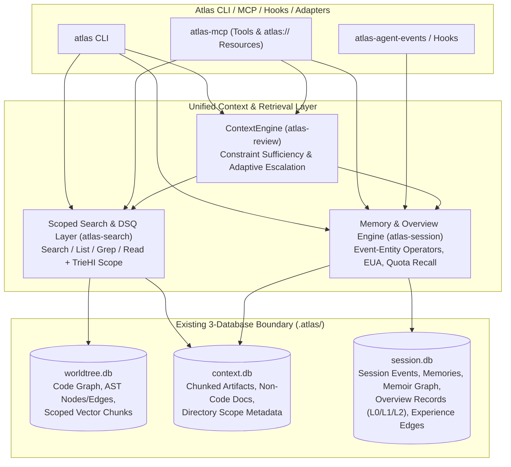

# Assessment & Specification: Adapting VikingMem, VikingRAG, and TrieHI for Atlas

Yes. The core mechanisms introduced in **VikingMem** (arXiv:2605.29640v3), **VikingRAG** (arXiv:2609.11390v1), and **TrieHI** (arXiv:2606.16903v1) are well-suited for Atlas, provided we adapt their data management principles directly into Atlas's existing Rust workspace, SQLite storage boundaries, and non-LLM-first execution model rather than porting OpenViking wholesale.

This document evaluates the three papers against the current Atlas codebase (`SHIPPED.md`, `ISSUES.md`, `packages/atlas-session`, `packages/atlas-contentstore`, `packages/atlas-search`, `packages/atlas-review`, `packages/atlas-store-sqlite`, and `packages/atlas-mcp`) and specifies concrete architectural and code-level improvements.

### Core Recommendation

- **VikingMem (`arXiv:2605.29640v3`)**: Adopt its **Event–Entity state algebra**, **statistical operators (`SET`, `SUM`, `COUNT`, `MAX`, `AVG`)**, **Entity Update Algorithm (`EUA` search/replace patching)**, **topic-timeline `TIME_COMPRESS` consolidation**, and **two-path quota-based recall** by extending `packages/atlas-session` (`memories`, `curation.rs`, `memory_recall.rs`, `memoir.rs`) and `Patch X` (`Runtime Event Enrichment`).
- **VikingRAG (`arXiv:2609.11390v1`)**: Adopt its **prompt-decoupled `atlas://` hierarchical URI namespace**, **L0/L1/L2 multi-granular representations** (unifying directly with **ICM-G `overview_records`**), **`Search`/`List`/`Grep`/`Read` scoped access primitives**, **query-conditioned Experience Edges (`VikingRAG-E`)**, and **constraint-aware Adaptive Retrieval Escalation (`VikingRAG-E+`)** (unifying with **`Patch E` Context Escalation Contract**).
- **TrieHI (`arXiv:2606.16903v1`)**: Adopt its **Directory-Semantic Query (`DSQ`: recursive, non-recursive, exclusion)** and **Directory-Semantic Maintenance (`DSM`: subtree move/merge)** primitives, starting with normalized parent-directory scoping in `context.db` and `worldtree.db`, and adding an in-memory prefix-tree (`TrieNode` with `inclusive_ids` bitmaps) on demand when vector filtering or deep subtree queries warrant it.
- **OpenViking (`github.com/volcengine/openviking`)**: Study as an architectural reference only. Because OpenViking is licensed under **AGPL-3.0** while Atlas is **MIT / Apache-2.0**, all capabilities must be cleanly designed and implemented in Rust from the published algorithmic specifications.

---

## 1. Research Synthesis: Key Mechanisms from the Three Papers

### 1.1 VikingMem: Stateful Event–Entity Memory Management (`arXiv:2605.29640v3`)

VikingMem formulates the **Memory Base** around three principles: selective extraction from low-signal streams, stateful evolution via operators, and schema-driven generalizability.

1. **Event–Entity Algebra**:
   - **Events** are immutable, timestamped episodic records selectively extracted from interaction streams.
   - **Entities** are materialized, evolving state views over the event log, expressed parametrically as:
     $$\text{Entity} = \mathsf{OP}\bigl(\text{SELECT events GROUP BY } \text{keys} \text{ WHERE } \text{filters}\bigr)$$
2. **Operator Library (`OP`)**:
   - **Statistical Operators (`SET`, `SUM`, `COUNT`, `MAX`, `AVG`)**: Execute deterministically without LLM calls to prevent arithmetic drift and eliminate token overhead.
   - **Synthesis Operators (`LLM_MERGE`, `TIME_COMPRESS`)**: Incrementally resolve semantic conflicts or compress aging topic timelines into periodic summaries while assigning TTLs to underlying fine-grained events.
3. **Entity Update Algorithm (`EUA`, Algorithm 1)**:
   - Avoids round-trip LLM entity rewrites by emitting compact field patches (`<<<< SEARCH ... ==== ... >>>> REPLACE`) applied deterministically via edit-distance approximate matching against top-$k$ candidate entities.
4. **Two-Path Quota-Based Recall**:
   - **Primary Path**: Hybrid search scored by a convex combination of normalized origin relevance, exponential time-decay after a freshness tolerance window, and type/instance importance:
     $$S_{\text{final}} = (1 - w_{\text{time}} - w_{\text{busi}})\cdot S_{\text{origin}} + w_{\text{time}}\cdot S_{\text{time}} + w_{\text{busi}}\cdot S_{\text{busi}}$$
   - **Auxiliary Path**: Keyword/concept graph traversal (`memoir`) to recover memories with low direct lexical/semantic overlap.
   - **Quota Merge**: Rather than naively pooling raw scores across paths, each path ranks candidates independently and fills a dedicated quota before final presentation.

---

### 1.2 VikingRAG: Hierarchical, Evidence-Gap-Driven Retrieval (`arXiv:2609.11390v1`)

VikingRAG targets the accuracy-versus-token trade-off in structured corpora (where systems like DeepRead burn tokens by serializing entire directory trees into prompts).

1. **Prompt-Decoupled Hierarchical Storage ($\mathcal{S}[D] = \langle \mathcal{H}_D, \phi_D, \mathcal{I}_D \rangle$)**:
   - Materializes structural nodes, multi-granular abstracts ($\mathcal{A}_D$), and chunks ($\mathcal{C}_D$) into an injective, prefix-preserving URI namespace ($\phi_D(v) \preceq_{\mathcal{U}} \phi_D(x)$).
   - Keeps hierarchy external to the prompt; every semantic hit returns a URI whose prefix immediately scopes enclosing directory navigation.
2. **Four Scoped Access Primitives**:
   - $\textsc{Search}(q, u, K)$: Semantic/hybrid search restricted to URI subtree $u$.
   - $\textsc{List}(u)$: Immediate children of directory URI $u$ (never dumps the full tree).
   - $\textsc{Grep}(p, u)$: Lexical/regex match scoped to URI subtree $u$.
   - $\textsc{Read}(u)$: Loads the exact content of a URI-addressed object (L0 abstract, L1 overview, or L2 chunk/span).
3. **Experience Edges (`VikingRAG-E`, Algorithms 2 & 3)**:
   - After a successful multi-round investigation $\tau$, constructs directed edges $\varepsilon_{v \rightarrow u} = (v, u, r_\varepsilon)$ from initial search seed URIs $v \in \mathcal{U}_{\mathrm{src}}$ to verified answer-supporting URIs $u \in \mathcal{U}_{\mathrm{tgt}} \setminus \mathcal{U}_{\mathrm{edge}}$.
   - Attaches payload $r_\varepsilon = (\mathbf{z}_Q, H)$ containing the historical query representation $\mathbf{z}_Q$ and compact trace summary $H$.
   - Maintains reverse pointers at $u$ for $O(1)$ local edge invalidation when $u$ is modified or deleted.
   - Activates $\varepsilon_{v \rightarrow u}$ on future query $Q'$ only when $\operatorname{sim}(\mathbf{z}_{Q'}, \mathbf{z}_Q) \ge \gamma$ (default $\gamma = 0.8$).
4. **Adaptive Retrieval Escalation (`VikingRAG-E+`, Section 5)**:
   - Executes one-round experience-augmented retrieval first, then runs a **constraint-aware evidence sufficiency check** (verifying required entities, scope, callers/callees, invariants).
   - Escalates to multi-round retrieval only when explicit constraints remain unverified.

---

### 1.3 TrieHI: Directory-Aware Query and Maintenance (`arXiv:2606.16903v1`)

TrieHI formalizes directory topology as a first-class scope-resolution layer decoupled from the underlying ANN/retrieval executor.

1. **Directory-Semantic Query (`DSQ`)**:
   - **Recursive Query**: All entries in the subtree rooted at path $p$, i.e., $\operatorname{Inc}(p)$.
   - **Non-Recursive Query**: Only entries bound directly to $p$:
     $$\operatorname{Local}(p) = \operatorname{Inc}(p) \setminus \bigcup_{c \in \operatorname{Child}(p)} \operatorname{Inc}(c)$$
   - **Branch Exclusion**: $\operatorname{Inc}(p) \setminus \operatorname{Inc}(p_{\text{exclude}})$.
2. **Directory-Semantic Maintenance (`DSM`)**:
   - **Subtree Move (`MOVE`)** & **Subtree Merge (`MERGE`)**: Relinks trie nodes and updates ancestor `inclusive_ids` sets ($A^-$ and $A^+$) in $O(t)$ ancestor steps without rewriting descendant path strings.

---

## 2. Double-Check of Current Atlas Implementation: Strengths & Concrete Gaps

Auditing the current workspace against the three papers reveals that Atlas already has strong foundational infrastructure—and several in-flight features in `ISSUES.md`—that map directly onto these papers, alongside specific technical gaps where Atlas can be improved.

### 2.1 Storage Boundaries (Keep Unchanged)

Atlas enforces strict three-database separation under `.atlas/` (`docs/architecture.md`):
- **`.atlas/worldtree.db`** (`packages/atlas-store-sqlite`): Static code graph facts (`nodes`, `edges`, `files`, `retrieval_chunks`, `node_history`, `edge_history`).
- **`.atlas/context.db`** (`packages/atlas-contentstore`): Chunked artifacts, saved context, FTS5 (`chunks_fts`), trigram index (`chunks_trigram`), and vocabulary (`sources`, `chunks`).
- **`.atlas/session.db`** (`packages/atlas-session`): Session ledger (`session_events`), `memories`, `memory_supersessions`, `decision_memories`, `feedback_records`, `memoir_graphs`/`memoir_concepts`/`memoir_relations`, `global_*_access`, and the new `overview_records` (`012_overview_memory.sql`).

**Rule**: Do not add a fourth database or merge runtime/memory state into `worldtree.db`.

---

### 2.2 Audit of `packages/atlas-session` (Memory, Curation, Recall, Memoir, Overviews)

| Subsystem & File | What Atlas Already Implements | Concrete Gaps & Opportunities Identified from Papers |
| :--- | :--- | :--- |
| **Shared Memory & Consolidation**<br>`packages/atlas-session/src/store/memory.rs` | - `memories` table (migrations `007` + `009`) with `topic`, `title`, `body`, `importance`, `decay_score`, `source_id`, `superseded_by`.<br>- `consolidation_plan()` groups rows by `topic` + exact normalized `title`, `body`, `source_id`, or `metadata.category`.<br>- Creates `memory_supersessions` links. | **Gap 1 (No State Synthesis in Consolidation)**: In `memory.rs:757-769`, `consolidation_plan` simply clones `kept = &members[0]` (`kept.title`, `kept.body`) and marks `members[1..]` as superseded. Any unique details in `members[1..]`'s body are hidden from default recall!<br>**Gap 2 (No Typed Operators or EUA)**: Lacks VikingMem's deterministic operator trait (`SET`, `SUM`, `COUNT`, `MAX`, `AVG`, `APPEND_UNIQUE`) and `EUA` (`<<<< SEARCH ... ==== ... >>>> REPLACE`) fuzzy patching for structured entity state updates. |
| **Event Curation & Global Memory**<br>`packages/atlas-session/src/store/curation.rs`<br>`packages/atlas-session/src/store/global_memory.rs` | - `compact_session_events` deletes excess `FILE_READ` (>3/path), `GRAPH_BUILD` (>1), `COMMAND_RUN` (>3/cmd), `CONTEXT_REQUEST` (>2/target), deduplicates `REASONING_RESULT`, and promotes `DECISION`/`USER_INTENT`.<br>- `global_memory.rs` tracks `COUNT` + `MAX(last_accessed)` for symbols, files, and 3-gram command sequences. | **Gap 3 (Hard Deletion vs. `TIME_COMPRESS`)**: `curation.rs:208-211` executes `DELETE FROM session_events` for decayed/merged events without emitting a compressed topic/timeline summary or preserving aggregated counters (`fail_count`, `read_count`).<br>**Gap 4 (Scattered Operators)**: `global_memory.rs` hardcodes SQL `access_count + 1` instead of using a unified Event-to-Entity operator pipeline fed by `Patch X` (`Runtime Event Enrichment`). |
| **Cross-Session Memory Recall**<br>`packages/atlas-session/src/store/memory_recall.rs` | - `recall_memories()` ranks candidates using `LEXICAL_TIER_WEIGHT` (2000), `IMPORTANCE_WEIGHTS` (1200/800/400/0), `SCOPE_WEIGHTS`, `SOURCE_BACKED_WEIGHT`, and hyperbolic recency `25.0 / (1.0 + age_days / 30.0)`. | **Gap 5 (Substring `LIKE` Only; No FTS5 or Quota Path)**: `memory_recall.rs:60-75` uses `topic LIKE '%query%' OR title LIKE '%query%' OR body LIKE '%query%'`. Multi-word queries fail if words are non-adjacent, and `memoir` (`ICM-F`) is not queried as an auxiliary quota-based recall path during `recall_memories()`. |
| **Memoir Concept Graph**<br>`packages/atlas-session/src/store/memoir.rs` | - **ICM-F is shipped**: `memoir_graphs`, `memoir_concepts`, `memoir_relations` with controlled vocabulary (`depends_on`, `part_of`, `contradicts`, `refines`, `replaces`, `caused_by`, `fixed_by`, `blocked_by`, `decided_by`, `related_to`) and bounded BFS `inspect`. | **Gap 6 (Disconnected from Memory Recall)**: `PLAN-RAG.md` previously proposed building a new "keyword graph for memory." Instead, `memoir` *is* that graph—it just needs an auxiliary recall path in `memory_recall.rs` that maps query terms to `memoir_concepts`, traverses 1–2 hops, and fills a bounded auxiliary recall quota. |
| **Code Overview Memory**<br>`packages/atlas-session/src/store/overview/`<br>`migrations/012_overview_memory.sql` | - **ICM-G1 & G2 are implemented**: `OverviewSubjectKind` (`project`, `package`, `module`, `file`, `symbol`, `function`, `method`), `OverviewFreshness` (`fresh`, `possibly_stale`, `stale`, `orphaned`, `unverified`), `overview_records` table, and `overview_record_fts`. | **Gap 7 (Unify with VikingRAG L0/L1/L2)**: `OverviewRecord` already stores `title` + `summary` (**L0 Abstract**, capped at `OVERVIEW_SUMMARY_MAX_CHARS`), `description_preview` + `responsibilities`/`flow`/`invariants` (**L1 Overview**), and `source_id` + `canonical_file_path`/`line_start..line_end` (**L2 Full Details**). VR1 should directly build on `overview_records` rather than inventing a parallel L0/L1/L2 table! |

---

### 2.3 Audit of `packages/atlas-contentstore`, `atlas-store-sqlite`, `atlas-search`, and `atlas-review`

| Subsystem & File | What Atlas Already Implements | Concrete Gaps & Opportunities Identified from Papers |
| :--- | :--- | :--- |
| **Content Store**<br>`packages/atlas-contentstore/src/store/search.rs` | - FTS5 (`chunks_fts`) + trigram fallback (`chunks_trigram`) + RRF merge + proximity reranking + vocabulary Levenshtein correction.<br>- `sources` has `identity_kind` and `identity_value`. | **Gap 8 (No Directory/Subpath Scope Filter in `SearchFilters`)**: `SearchFilters` (`packages/atlas-contentstore/src/store/types.rs`) only filters by `session_id`, `agent_id`, `source_type`, and `repo_root`. It cannot filter by directory prefix (`subpath`), non-recursive directory, or branch exclusion (`DSQ`).<br>**Gap 9 (Hardcoded `LIMIT 50`)**: `search.rs:52` and `130` hardcode `LIMIT 50` before caller filtering. |
| **Graph & Vector Store**<br>`packages/atlas-store-sqlite/src/store/search.rs` & `retrieval.rs` | - `Store::search` supports `subpath` via `n.file_path LIKE 'subpath%'` (recursive prefix only).<br>- `retrieval.rs` stores embeddings as `f32` blobs in `retrieval_chunks`. | **Gap 10 (Unscoped Full-Table Vector Scan)**: In `packages/atlas-store-sqlite/src/store/retrieval.rs:190-220`, `nodes_by_vector_similarity` runs `SELECT node_qn, embedding FROM retrieval_chunks WHERE embedding IS NOT NULL` across the **entire repository** and computes cosine similarity in-memory, ignoring `query.subpath`, `query.repo_ids`, `query.kind`, and `query.language`! Applying TrieHI/DSQ scope pre-filtering before cosine scoring will immediately cut vector latency and cross-module noise. |
| **Context Engine**<br>`packages/atlas-review/src/context/` | - `ContextEngine::build` coordinates graph targets (`worldtree.db`), `saved_context_sources` (`context.db`), and `content_assets` (`context.db`), enforcing `BudgetPolicy` and `TokenCounter`. | **Gap 11 (Single-Pass Retrieval; No Evidence-Gap Check)**: `build_context` runs a single static pass (`BUCKET_CALLERS=15`, `BUCKET_CALLEES=15`, etc.). If a symbol has dynamic dispatch, unresolved imports, missing test coverage, or truncated neighbor buckets, it does not diagnose the specific evidence gap or trigger targeted follow-up retrieval.<br>**Gap 12 (No Experience Edges)**: Successful multi-tool investigation paths (`query_graph` $\to$ `symbol_neighbors` $\to$ `read_file_excerpt`) are recorded as flat session events (`global_workflow_patterns` only tracks command-name 3-grams, not URI-to-URI evidence shortcuts). |
| **MCP Resources**<br>`packages/atlas-mcp/src/resources.rs` | - Exposes `atlas://docs/index`, `atlas://health/status`, `atlas://graph/provenance`, `atlas://saved-context/{id}`, `atlas://tool-docs/{name}`. | **Gap 13 (Incomplete `atlas://` Hierarchical Namespace)**: Does not yet expose `atlas://projects/{repo}/...`, `atlas://overviews/{subject_kind}/{path}#L0|L1|L2`, or `atlas://memories/{topic}` for unified `Search`/`List`/`Grep`/`Read` navigation. |

---

## 3. Architectural Mapping to Atlas

We map the three papers onto Atlas's existing crates and three SQLite databases without introducing new standalone database files:



---

## 4. Concrete Adaptations from VikingMem (`packages/atlas-session`)

### 4.1 Event–Entity Model & Typed Operator Algebra (`VM1`)

Instead of creating a separate entity database, formalize the relationship between `session_events` / `RuntimeInput` (**Events**) and `memories` / `overview_records` / `global_*` (**Entities**) inside `packages/atlas-session`:

| Incoming Atlas Event (`session_events` / `Patch X`) | Target Atlas Entity (`session.db`) | Operator(s) Applied |
| :--- | :--- | :--- |
| `DECISION` / architectural choice recorded | `memories` (`importance = critical`, topic entity) | `SET` / `EUA_PATCH` / `SUPERSEDE` |
| `COMMAND_FAIL` / test or build failure classified (`Patch X3`) | `memories` (`topic = test-failures` or `build-errors`) | `COUNT`, `MAX(timestamp)`, `APPEND_UNIQUE(error_signature)` |
| `feedback_record` (`predicted != actual`) (`ICM-C`) | `feedback_records` + analysis rule entity | `COUNT`, `SET(confidence_penalty)` |
| Symbol / file / tool trajectory accessed | `global_symbol_access`, `experience_edges` | `SUM`, `COUNT`, `MAX(last_accessed)` |
| Topic timeline ages past active window (`ICM-B3`) | Consolidated topic `MemoryRecord` | `TIME_COMPRESS` (deterministic synthesis + `memory_supersessions`) |

Define a deterministic Rust operator trait in `packages/atlas-session/src/store/memory.rs`:

```rust
pub enum MemoryOp {
    /// Overwrite scalar property or structured section.
    Set { field: String, value: serde_json::Value },
    /// Accumulate numeric delta (e.g. occurrence or token counts).
    Sum { field: String, delta: i64 },
    /// Increment occurrence counter and stamp last_seen.
    Count { field: String },
    /// Retain maximum observed value (e.g. peak complexity, latest timestamp).
    Max { field: String, value: serde_json::Value },
    /// Retain running average `(old_avg * count + new_val) / (count + 1)`.
    Avg { field: String, sample: f64 },
    /// Append unique item to a bounded JSON array field (e.g. source_ids, error codes).
    AppendUnique { field: String, item: serde_json::Value, max_items: usize },
    /// Apply VikingMem EUA search-and-replace patch block with bounded Levenshtein fallback.
    EuaPatch { search: String, replace: String, max_edit_distance: usize },
    /// Synthesize multiple group members into a structured timeline summary.
    TimeCompress { window_label: String },
}
```

### 4.2 Fixing `atlas memory consolidate`: Non-Destructive Synthesis & `EUA` (`VM2`)

**Current Bug/Limitation in `packages/atlas-session/src/store/memory.rs:757-769`**:
When `consolidation_plan()` merges a group of $N$ memories (`members[0..N]`), it copies `members[0].body` verbatim into the new consolidated record and marks `members[1..]` as `superseded_by = record.id`. If `members[1]` had complementary details (e.g., a second edge case under the same topic/category), that text is hidden from default recall.

**Improvement**:
1. **Deterministic Structured Merge (`TIME_COMPRESS` without LLM)**:
   - When consolidating $N$ memories under a topic, deduplicate normalized sentences/bullet lines across all `members[0..N]` in chronological order (`created_at ASC`), preserving distinct facts up to `OVERSIZED_BODY_CHARS` (and routing overflow to `context.db` with `merged_source_ids`).
2. **Entity Update Algorithm (`EUA` Patching)**:
   - Support `<<<< SEARCH ... ==== ... >>>> REPLACE` patch blocks in `atlas memory store --patch-id <memory_id>` and MCP `memory_store` (as well as external analyzer ingest in `ICM-G4`).
   - Use bounded edit-distance matching (reusing `strsim::levenshtein` already in the workspace) so agents can surgically update an evolving architectural memory or `OverviewRecord` without re-emitting the entire document or losing provenance (`memory_supersessions`).

### 4.3 Upgrading `curation.rs`: `TIME_COMPRESS` Before Event Deletion (`VM3`)

**Current Limitation in `packages/atlas-session/src/store/curation.rs:208-211`**:
`compact_session_events` deletes older `FILE_READ`, `COMMAND_RUN`, and `CONTEXT_REQUEST` events directly.

**Improvement**:
- Before executing `DELETE FROM session_events`, aggregate the evicted events per topic/file/command into a compact `SESSION_SUMMARY` metadata record (storing `total_reads`, `command_runs`, `failure_count`, `first_seen`, `last_seen`, and `source_ids`).
- Enforce permanent protection for `DECISION` and `critical` memories unless explicitly superseded with contradiction evidence.

### 4.4 Two-Path Quota-Based Recall with `memoir` & FTS5 (`VM4` / `ICM-E`)

**Current Limitation in `packages/atlas-session/src/store/memory_recall.rs`**:
1. Uses single-string `LIKE '%query%'` (`memory_recall.rs:60-75`), which misses multi-token queries where tokens appear in different positions across `topic`, `title`, and `body`.
2. Never consults the shipped `memoir_concepts` / `memoir_relations` tables (`ICM-F`).

**Improvement**:
1. **Add `memories_fts` (or token-split matching) + VikingMem Time-Decay Curve**:
   - Upgrade `recall_memories` to support multi-token FTS5/BM25 lexical matching alongside the existing exact-topic tier (`LEXICAL_TIER_WEIGHT`).
   - Support a configurable freshness tolerance window (e.g. `freshness_window_days = 1`, where $S_{\text{time}} = 1.0$, followed by exponential/hyperbolic decay).
2. **Wire `memoir` (`ICM-F`) as VikingMem's Auxiliary Recall Path with Quota Allocation**:
   - **Primary Path Quota ($Q_{\text{primary}} = \lceil 0.75 \times \text{limit} \rceil$)**: Direct lexical + importance + recency + optional vector recall over `memories`.
   - **Auxiliary Path Quota ($Q_{\text{aux}} = \text{limit} - Q_{\text{primary}}$)**: Match query tokens against `memoir_concepts.name` / `description`, traverse 1–2 hops across `memoir_relations` (`caused_by`, `fixed_by`, `decided_by`, `replaces`, `depends_on`), and resolve linked `source_id` / `memories` rows that were not already surfaced by the primary path.
   - Rank each path independently before merging by quota, exactly as validated in VikingMem §3.3.

---

## 5. Concrete Adaptations from VikingRAG (`atlas-session`, `atlas-search`, `atlas-review`, `atlas-mcp`)

### 5.1 Unifying VikingRAG L0/L1/L2 with `ICM-G` (`overview_records`) (`VR1`)

**Status:** implemented. `overview/levels.rs` renders `l0`/`l1`/`l2` views over
`overview_records`, `resources/uris.rs` owns the `atlas://` namespace, and
`atlas uri read|list|grep|search` mirrors the MCP resource handlers.

`PLAN-RAG.md` originally proposed creating a new L0/L1/L2 context hierarchy from scratch. However, **`ICM-G` (`Code Overview Memory`, migration `012_overview_memory.sql` and `packages/atlas-session/src/store/overview/`) is already partially implemented in the codebase** and models the exact same multi-granular hierarchy!

We should unify VikingRAG's 3-level representation directly with `OverviewRecord` and `atlas://` URIs:

| VikingRAG Level | Token Budget Target | Concrete Atlas Backing in `overview_records` / `worldtree.db` / `context.db` |
| :--- | :--- | :--- |
| **L0 — Abstract** | ~50–150 tokens | `OverviewRecord.title` + `OverviewRecord.summary` (`OVERVIEW_SUMMARY_MAX_CHARS`), or deterministic graph signature + doc-comment first sentence when no external overview is ingested yet. |
| **L1 — Overview** | ~500–2,000 tokens | `OverviewRecord.description_preview` + `responsibilities`, `flow`, `inputs`, `outputs`, `invariants`, `gotchas` (`overview_records`), plus direct graph caller/callee summary. |
| **L2 — Full Details** | On-demand bounded | Exact source code spans (`read_file_excerpt`), full artifact chunks in `context.db` via `OverviewRecord.source_id`, and raw test/implementation bodies. |

**Prompt-Decoupled `atlas://` URI Namespace**:
Extend `packages/atlas-mcp/src/resources.rs` and CLI lookup resolvers so every structural node, overview, memory, and artifact shares a canonical prefix-preserving URI:
```text
atlas://
├── repo/{repo_id}/
│   ├── tree/{canonical_dir_path}/          # Directory node (L0/L1 module overview + child list)
│   ├── file/{canonical_file_path}          # File node (L0 summary, L1 overview, L2 source)
│   └── symbol/{qualified_name}             # Symbol node (L0 signature/summary, L1 overview, L2 span)
├── memories/
│   ├── topic/{topic}                       # Topic timeline (consolidated entity + recent events)
│   └── id/{memory_id}                      # Individual memory record
├── memoir/
│   └── {graph_name}/{concept_name}         # Concept node + 1-hop relations
└── artifacts/
    └── {source_id}/{chunk_index}           # Saved context or non-code content chunk
```

### 5.2 Scoped Access Primitives (`Search`, `List`, `Grep`, `Read`)

**Status:** implemented for the `atlas://` surfaces. `Read`/`List`/`Grep`/
`Search` are exposed through MCP resources and `atlas uri`; `?level` controls
progressive disclosure.

VikingRAG proves that agents consume 50%–88% fewer tokens when they navigate hierarchies via four scoped primitives instead of receiving dumped directory trees:

| VikingRAG Primitive | Atlas CLI / MCP Surface | Required Improvement in Atlas |
| :--- | :--- | :--- |
| $\textsc{Search}(q, u, K)$ | `query_graph`, `search_content`, `overview_search`, `memory_recall` | Add `scope_uri` / `subpath` + `recursive: bool` + `exclude_subpaths: Vec<String>` + `level: L0\|L1\|L2` across both `Store::nodes_by_vector_similarity` (`worldtree.db`) and `ContentStore::search` (`context.db`). |
| $\textsc{List}(u)$ | `list_symbols`, `search_files`, `atlas://repo/{id}/tree/{dir}` | Add immediate-children directory listing mode (`recursive = false`) that returns child directories, files, and L0 abstracts without serializing the entire repo tree. |
| $\textsc{Grep}(p, u)$ | `search_content` (regex/literal), `query_graph` (`regex`) | Ensure `ContentStore::search` supports `subpath` prefix and exact parent-directory scoping before running FTS5/trigram/regex matching. |
| $\textsc{Read}(u)$ | `read_file_excerpt`, `read_saved_context`, `overview_show` | Allow reading any `atlas://` URI at `level = "l0" \| "l1" \| "l2"` (defaulting to L1 for directories/modules and L2 for targeted code spans). |

### 5.3 Evidence-Gap-Driven Retrieval & Adaptive Escalation (`VR2` & `VR4` $\leftrightarrow$ `Patch E`)

In `ISSUES.md`, **`Patch E` (Context Escalation Contract)** already defines minimal-context-first workflows (`get_minimal_context` $\to$ `get_review_context` $\to$ `explain_change` $\to$ `get_impact_radius`). VikingRAG's **Evidence-Gap-Driven Retrieval** and **Constraint-Aware Sufficiency Check (`VikingRAG-E+`)** provide the exact algorithmic mechanism to automate `Patch E2.5` and `Patch E3`:

1. **Deterministic Constraint Sufficiency Check (`EvidenceSufficiencyReport`)**:
   Instead of using an LLM call to judge sufficiency (which violates Atlas's non-LLM-by-default invariant), Atlas can compute **deterministic structural sufficiency constraints** in `ContextEngine::build` (`packages/atlas-review/src/context/`):
   - **`target_resolved`**: Did the target resolve uniquely (`AmbiguityMeta == None`)?
   - **`callers_complete`**: Were direct callers retrieved without hitting `BUCKET_CALLERS` truncation?
   - **`tests_covered`**: For safety/removal/review intents, is at least one test neighbor or test file attached, or is the absence of tests explicitly verified?
   - **`dispatch_complete`**: Are there unresolved cross-file edges, trait implementations (`Implements` edges), or dynamic route registrations that were omitted?
   - **`overview_fresh`**: If `include_overviews` is enabled, are matched `OverviewRecord`s `Fresh` (`OverviewFreshness::Fresh`) rather than `Stale` or `Orphaned`?
2. **Targeted Evidence-Gap Follow-Up (Bounded Multi-Round inside `ContextEngine`)**:
   - When Round 1 (`get_minimal_context` / L0+L1 + 1-hop) fails a required constraint (e.g., `tests_covered == false` on a `Review` or `Remove` check, or `Implements` trait targets are missing), `ContextEngine` performs a **targeted Round 2 lookup** (up to a strict round budget $B \le 3$ and within `TokenCounter` budget) specifically for the missing constraint—rather than uniformly doubling `max_nodes` across the whole graph.
   - Emits `evidence_gaps: Vec<EvidenceGap>`, `sufficiency_score: f64`, `escalation_reason`, and `next_tools` in `ContextResult` metadata (`Patch E3`).

### 5.4 Query-Conditioned Experience Edges (`VR3`)

Currently, `packages/atlas-session/src/store/global_memory.rs` only tracks unconditioned access counts (`global_symbol_access`, `global_file_access`) and coarse 3-command strings (`global_workflow_patterns`).

Following **VikingRAG-E (Algorithms 2 & 3)**, add an `experience_edges` table in `session.db` (migration `013_experience_edges.sql`):

```sql
CREATE TABLE IF NOT EXISTS experience_edges (
    id                  TEXT PRIMARY KEY,
    repo_root           TEXT NOT NULL,
    source_uri          TEXT NOT NULL, -- e.g. atlas://repo/root/symbol/api::router::handle
    target_uri          TEXT NOT NULL, -- e.g. atlas://repo/root/file/src/auth/middleware.rs
    query_text          TEXT NOT NULL,
    query_tokens_json   TEXT NOT NULL DEFAULT '[]',
    query_embedding     BLOB,          -- optional f32 LE vector when embedding provider is configured
    trace_summary       TEXT NOT NULL, -- compact tool-call path H that discovered target from source
    commit_sha          TEXT NOT NULL,
    source_file_hash    TEXT,
    target_file_hash    TEXT,
    use_count           INTEGER NOT NULL DEFAULT 1,
    confidence          REAL NOT NULL DEFAULT 1.0,
    created_at          TEXT NOT NULL,
    last_validated_at   TEXT NOT NULL,
    UNIQUE (repo_root, source_uri, target_uri, query_text)
);

CREATE INDEX IF NOT EXISTS idx_experience_edges_source
    ON experience_edges(repo_root, source_uri);
CREATE INDEX IF NOT EXISTS idx_experience_edges_target
    ON experience_edges(repo_root, target_uri);
```

**Key Atlas-Specific Safeguards for Experience Edges**:
1. **Redundancy Suppression ($\mathcal{U}_{\mathrm{tgt}} \setminus \mathcal{U}_{\mathrm{edge}}$)**: As proven in VikingRAG Algorithm 2 Line 5, URIs reached via an existing experience edge during a session are excluded when constructing new edges so Atlas never creates redundant transitive edge explosion.
2. **Reverse Index & Code-Churn Invalidation**: `idx_experience_edges_target` acts as VikingRAG's reverse index at $u$. When a file or symbol is deleted or its `file_hash` changes during `atlas update`, incoming and outgoing experience edges for affected URIs are either invalidated or marked `possibly_stale` until re-verified.
3. **Dual Activation Threshold ($\gamma$)**:
   - When embeddings are enabled: activate edge $\varepsilon_{v \rightarrow u}$ if $\cos(\mathbf{z}_{Q'}, \mathbf{z}_Q) \ge \gamma$ (default $\gamma = 0.80$).
   - When running in Atlas's default lexical-only mode: activate edge if normalized token Jaccard / BM25 overlap between $Q'$ and `query_tokens_json` $\ge \gamma_{\text{lex}}$ (default $0.65$) and target intent matches.
4. **Never Treated as Code Graph Truth**: Experience edges live in `session.db`, never in `worldtree.db`, and are surfaced as `SelectionReason::ExperienceShortcut` in `ContextResult` with provenance.

---

## 6. Concrete Adaptations from TrieHI (`atlas-contentstore` & `atlas-store-sqlite`)

### 6.1 Immediate Fix: Pre-Filtering Vector & Content Search by Directory Scope (`DSQ`)

The TrieHI paper (`arXiv:2606.16903v1`) demonstrates that directory constraints must be resolved into a valid candidate set *before* ranking. Our code audit found two places where Atlas currently violates this:

1. **`packages/atlas-store-sqlite/src/store/retrieval.rs` (`nodes_by_vector_similarity`)**:
   - Currently loads **all** embeddings in `retrieval_chunks` without filtering by `query.subpath`, `query.repo_ids`, `query.kind`, or `query.language`.
   - **Fix**: Join or pre-filter `retrieval_chunks` against `nodes` using the `DSQ` scope predicate (recursive prefix, non-recursive exact `parent_dir`, or excluded subpaths) so cosine similarity is only evaluated on in-scope symbols.
2. **`packages/atlas-contentstore/src/store/search.rs` (`ContentStore::search` & `search_trigram`)**:
   - Currently lacks directory filtering in `SearchFilters` and hardcodes `LIMIT 50`.
   - **Fix**: Add `parent_dir` and canonical `relative_path` columns (migration `010_directory_hierarchy.sql` in `atlas-contentstore`), extend `SearchFilters` with `subpath_prefix: Option<String>`, `exact_dir: Option<String>`, `exclude_prefixes: Vec<String>`, and `limit: usize`, and push the scope predicate into the SQL query before BM25 ranking.

### 6.2 Phased TrieHI Rollout: SQLite Adjacency First, In-Memory `TrieHI` Bitmap Index Second

Following Section IV of the TrieHI paper:
- **Stage 1 (SQLite Native `DSQ` & `DSM`)**:
  - Store normalized `parent_dir` on `files` (`worldtree.db`), `sources` (`context.db`), and `overview_records` (`session.db`) with composite indexes `(repo_root, parent_dir)` and `(repo_root, canonical_file_path)`.
  - Support **Non-Recursive DSQ** via exact match `parent_dir = ?1` ($O(\log N)$ index lookup, matching `PE-Online`'s $29\mu\text{s}$ sweet spot).
  - Support **Recursive DSQ** via range scan `canonical_file_path >= 'dir/' AND canonical_file_path < 'dir0'` (using standard B-tree byte-order range bounds instead of slower `LIKE` wildcard parsing).
  - Support **Branch Exclusion DSQ** via `AND NOT (canonical_file_path >= 'excl/' AND canonical_file_path < 'excl0')`.
- **Stage 2 (In-Memory `TrieHI` with Roaring Bitmaps for Vector Search)**:
  - When dense/hybrid vector search is active on large repositories or multi-repo federations (>50k chunks), construct a lightweight in-memory `DirectoryTrie` where each `TrieNode` holds a compressed bitmap (`roaring::RoaringBitmap` of `chunk_rowid`s) maintaining the TrieHI invariant:
    $$\operatorname{Inc}(v) = \operatorname{Local}(v) \cup \bigcup_{c \in \operatorname{Child}(v)} \operatorname{Inc}(c)$$
  - Git rename/move detection in `atlas-engine` (`update_graph`) maps directly to TrieHI's `DSM MOVE` operation: relink the moved directory node and update `Inc(v)` on $A^-$ and $A^+$ ancestors in $O(\text{depth})$ time.

---

## 7. Integrated Implementation Roadmap (Aligned with `ISSUES.md`)

Rather than creating a disconnected roadmap or referencing obsolete `atlas-todo-v6.txt` items, this track integrates directly with the active sections in `ISSUES.md`:

| Track ID | Title & Scope | Target Crates & Files | Relation to `ISSUES.md` |
| :--- | :--- | :--- | :--- |
| **VM1** | **Typed Event–Entity Operators & Non-Destructive Consolidation**<br>- Implement `MemoryOp` (`Set`, `Sum`, `Count`, `Max`, `Avg`, `AppendUnique`, `EuaPatch`, `TimeCompress`).<br>- Fix `consolidation_plan()` in `memory.rs` so `members[1..]` bodies are deterministically synthesized into the kept record rather than dropped.<br>- Add `EUA` search/replace patching with bounded edit-distance matching. | `packages/atlas-session/src/store/memory.rs`<br>`packages/atlas-session/src/store/types.rs` | Extends shipped **ICM-B3** & **Patch X** |
| **VM2** | **Session Curation `TIME_COMPRESS` & Enriched Event Aggregation**<br>- Update `compact_session_events()` in `curation.rs` to aggregate evicted low-level events into compact topic/session timeline summaries before deletion.<br>- Route `Patch X` enriched runtime events (`COMMAND_FAIL`, `ERROR`) through `MemoryOp` into durable topic entities. | `packages/atlas-session/src/store/curation.rs`<br>`packages/atlas-session/src/store/global_memory.rs` | Extends shipped **CM10/CM11** & **Patch X2–X5** |
| **VM3** | **Two-Path Quota-Based Memory Recall (Lexical/Vector + `memoir`)**<br>- Upgrade `recall_memories()` in `memory_recall.rs` from substring `LIKE` to token-aware FTS5 + configurable freshness tolerance window.<br>- Add auxiliary recall path over `memoir_concepts`/`memoir_relations` with independent path ranking and quota allocation ($75\%$ primary / $25\%$ auxiliary). | `packages/atlas-session/src/store/memory_recall.rs`<br>`packages/atlas-session/src/store/memoir.rs` | Completes **ICM-E1/E2** & connects shipped **ICM-F** |
| **VR1** | **Unified L0/L1/L2 Hierarchy over `ICM-G` (`overview_records`) & `atlas://` URIs**<br>- Map VikingRAG L0 (title/summary), L1 (description/responsibilities/flow/invariants), and L2 (source spans/artifacts) directly onto `overview_records` (`012_overview_memory.sql`).<br>- Expose `atlas://` hierarchical URIs and `Search`, `List`, `Grep`, `Read` level-aware access across CLI and MCP. | `packages/atlas-session/src/store/overview/`<br>`packages/atlas-mcp/src/resources.rs`<br>`packages/atlas-review/src/context/` | Unifies with in-flight **ICM-G1–G10** |
| **VR2** | **Directory-Semantic Query (`DSQ`) & Vector Scope Pre-Filtering**<br>- Fix `Store::nodes_by_vector_similarity` (`retrieval.rs`) to pre-filter by `subpath` (recursive, non-recursive `exact_dir`, and `exclude_subpaths`), `repo_ids`, `kind`, and `language`.<br>- Add `parent_dir` and `DSQ` filters (`subpath_prefix`, `exact_dir`, `exclude_prefixes`, configurable `limit`) to `ContentStore::search` (`search.rs`).<br>- Add optional in-memory `TrieHI` bitmap scope resolver when chunk count warrants it. | `packages/atlas-store-sqlite/src/store/retrieval.rs`<br>`packages/atlas-contentstore/src/store/search.rs`<br>`packages/atlas-search/src/hybrid.rs` | Extends shipped **Retrieval Sidecar** |
| **VR3** | **Constraint-Aware Evidence-Gap Retrieval & Adaptive Escalation**<br>- Implement deterministic `EvidenceSufficiencyReport` in `ContextEngine::build` checking symbol ambiguity, caller/callee bucket truncation, test coverage, trait/impl dispatch, and overview freshness.<br>- Perform bounded targeted Round-2 lookup only for missing constraints; emit `evidence_gaps` and `escalation_reason`. | `packages/atlas-review/src/context/build.rs`<br>`packages/atlas-review/src/context/mod.rs`<br>`packages/atlas-core/src/model/` | Directly implements **Patch E2.5 & E3** |
| **VR4** | **Query-Conditioned Experience Edges (`VikingRAG-E`)**<br>- Add migration `013_experience_edges.sql` in `atlas-session` with source/target URIs, query tokens/embedding, trace summary $H$, `commit_sha`, and file hashes.<br>- Implement online construction with $\mathcal{U}_{\mathrm{tgt}} \setminus \mathcal{U}_{\mathrm{edge}}$ redundancy suppression, reverse-index invalidation on file churn, and $\gamma$-thresholded activation during `ContextEngine::build`. | `packages/atlas-session/src/migrations/`<br>`packages/atlas-session/src/store/`<br>`packages/atlas-review/src/context/` | New enhancement complementing **Patch X7** & **Patch E** |
| **VQ1** | **Evaluation & Token-Efficiency Gates**<br>- Extend `packages/atlas-search/src/eval.rs` benchmark suite to measure L0/L1/L2 token savings, `DSQ` vector pre-filter speedup, `memoir` auxiliary recall lift, and experience-edge round reduction against existing baselines. | `packages/atlas-search/src/eval.rs` | Extends shipped **Retrieval Evaluation** & **Patch R7** |

---

## 8. Non-Negotiable Architectural & Safety Invariants

1. **Three-Database Separation**: `worldtree.db` holds static code graph facts only; `context.db` holds large artifacts and chunked text; `session.db` holds events, `memories`, `memoir`, `overview_records`, and `experience_edges`.
2. **Non-LLM Default Core**: All baseline memory operators (`SET`, `SUM`, `COUNT`, `MAX`, `AVG`, `EUA`, deterministic `TIME_COMPRESS`), `DSQ` scope filters, and `EvidenceSufficiencyReport` checks must run 100% locally and deterministically in Rust with zero required LLM or cloud embedding calls.
3. **No Silent Loss of Contradictory or Merged Evidence**: `atlas memory consolidate` and `TIME_COMPRESS` must preserve distinct facts from all merged rows and maintain `memory_supersessions` provenance links.
4. **Code-Churn Safe Shortcuts**: Experience edges (`VR4`) and overviews (`VR1`/`ICM-G`) are strictly bound to `commit_sha` and canonical file hashes; stale or orphaned links never masquerade as fresh structural graph edges.
5. **CLI and MCP Parity**: Every new flag, filter (`--subpath`, `--exact-dir`, `--exclude-subpath`, `--level l0|l1|l2`), and schema field must be synchronized across `atlas-cli` and `atlas-mcp` (`rmcp` typed descriptors and `MCP_TOOLS.md`).
6. **Clean-Room Licensing Compliance**: Implement directly from the published algorithmic descriptions in `arXiv:2605.29640v3`, `arXiv:2609.11390v1`, and `arXiv:2606.16903v1`; do not copy AGPL-3.0 code from OpenViking.

---

## 9. Primary References

- **VikingMem**: *VikingMem: A Memory Base Management System for Stateful LLM-based Applications* — [arXiv:2605.29640v3](https://arxiv.org/html/2605.29640v3) (VLDB 2026)
- **VikingRAG**: *VikingRAG: Accurate and Token-efficient Retrieval-augmented Generation over Structured Documents* — [arXiv:2609.11390v1](https://arxiv.org/html/2609.11390v1)
- **TrieHI**: *Directory-Aware Query and Maintenance in Vector Databases* — [arXiv:2606.16903v1](https://arxiv.org/html/2606.16903v1)
- **OpenViking (Reference Only — AGPL-3.0)**: [github.com/volcengine/openviking](https://github.com/volcengine/openviking)
